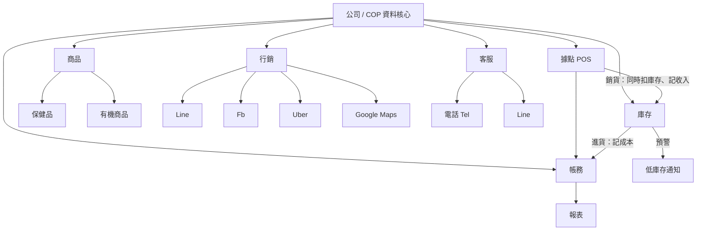

# 營運系統設計（v2，依清晰版組織圖）

> v2 以第二張清晰組織圖為主架構；第一張草圖的概念（COP 核心、錢貨一起、Line 記帳、每週貼文）整合進各模組。
> 字跡仍不確定處標記「❓」，集中在第 8 節請您確認。

## 1. 組織圖解讀

公司下分六大模組：

| 模組 | 圖上內容 | 系統功能 |
|---|---|---|
| **帳務** | 所有成本、收入、支出、報表 | 總帳、成本／收入／支出登錄、各式報表 |
| **庫存** | POS＋進銷貨；即時存貨／預警 | 即時存貨、低庫存預警，由 POS 與進銷貨驅動 |
| **商品** ❓（框內字像「營運」或「營養」） | 保健品、有機商品，旁邊另有一個字（上架？❓） | 商品主檔，兩大分類：保健、有機 |
| **行銷** | Line、Fb、Uber、Google Maps | 五個通路的貼文／上架／評論管理 |
| **客服** | Tel ＋ Line | 電話與 Line 客人問題紀錄、回覆、FAQ |
| **據點** ❓（像「據位／櫃位」） | POS、內…同步、進／銷貨 | 門市 POS，與庫存內部同步進銷貨 |

> 第一張圖的 COP 在這張圖對應「公司」這一層：六個模組共用同一份資料，COP = 共用的資料核心。

## 2. 整體架構



設計原則：
1. **一份資料**：商品、客戶、庫存、帳只存在 COP，各模組共用。
2. **錢貨同步**：POS 賣一筆 = 一筆收入（帳務）＋ 一筆庫存異動，同一個資料庫交易完成。進貨 = 一筆成本 ＋ 庫存增加。
3. **即時**：庫存隨交易立刻變動，達到門檻立刻預警。

## 3. 各模組設計

### 3.1 帳務
- 登錄類型：**收入、成本、支出**（對應圖上「所有成本、收入、支出」）。
- 來源：POS 自動、進貨自動、手動輸入、**Line 記帳**（傳一句話即記，機器人回覆確認；例：`支出 午餐 120`、`進貨 有機糙米 10包 2300`）。
- 報表：日／週／月損益、毛利、依商品分類（保健／有機）與通路分析、匯出 CSV 給會計。

### 3.2 庫存
- 存貨量 = 所有異動加總。異動只新增不修改：進貨、銷貨、退貨、盤點、報廢。
- **即時存貨**：每個商品、每個據點的當前數量。
- **預警**：低於安全庫存時通知（Line／畫面紅字）；可延伸「預估可售天數」。
- 進銷貨單：進貨單（供應商、成本）、銷貨由 POS 自動產生。

### 3.3 商品
- 商品主檔：名稱、分類（**保健／有機**）、單位、售價、成本、安全庫存、狀態。
- 保健品建議加批號與有效期限（❓視需求）。
- 「上架」：商品是否在各通路（Uber、Line 等）上架／可售的狀態（❓待確認這個字的意思）。

### 3.4 行銷
- 通路：Line、Fb、Uber、Google Maps。
- 功能：
  - 貼文／活動排程（Fb、Line；建議每週 1–2 篇，沿用第一張草圖）。
  - Uber：菜單／商品上架狀態、訂單（如需串接）。
  - Google Maps：商家資訊、評論回覆追蹤。
- 每個客人與訂單記錄來源通路，可比較各通路成效。

### 3.5 客服
- 管道：電話（Tel）＋ Line。
- 每筆客人問題記錄：客人、管道、內容、標籤、是否已回覆。
- 彙整成 FAQ，可回饋給行銷（貼文題材）與 Line 自動回覆。
- 電話只能手動登錄；Line 可由 webhook 自動進入收件匣。

### 3.6 據點（POS）
- 門市 POS：選品 → 結帳 → 完成。
- **內部同步**：結帳立刻同步庫存與帳務（圖上「POS 內…同步進／銷貨」）。
- 退貨／作廢：產生反向帳與反向庫存，不刪除。
- 多據點時，庫存按據點分開（❓是否多據點）。

## 4. 資料模型

```
store(id, name)                                              -- 據點
customer(id, name, phone, line_id, fb_id, source_channel)
inquiry(id, customer_id, channel[tel|line], content, tag, replied, replied_at)  -- 客服 / FAQ
post(id, channel[line|fb|uber|gmaps], topic, scheduled_date, status)            -- 行銷

item(id, name, category[health|organic], unit, price, cost, safety_stock, batch_tracking, active)
item_listing(item_id, channel, listed)                       -- 「上架」❓
stock_move(id, store_id, item_id, qty_delta, move_type[purchase|sale|return|adjust|scrap], ref_type, ref_id, batch_no, expiry, created_by, created_at)

purchase(id, supplier, total, created_at); purchase_line(...)
sale(id, store_id, customer_id, channel, total, pay_method, status[done|void], created_at); sale_line(...)

ledger(id, date, kind[income|cost|expense], amount, item_id?, store_id?, ref_type, ref_id, source[pos|purchase|line|manual], note, voucher_url)
```

規則：
- `sale` / `purchase` 建立時，同一交易內寫入 `ledger` 與 `stock_move`。
- `stock_move` 只新增；更正用反向異動。
- 現有庫存 = `SUM(qty_delta)`，按 `store_id, item_id` 分組。

## 5. 主要流程

- **銷貨**：POS 結帳 → 寫 `sale` + `ledger(收入)` + `stock_move(−)` → 檢查預警。
- **進貨**：建立進貨單（或 Line 傳「進貨 …」）→ `ledger(成本)` + `stock_move(+)`。
- **客服循環**：客人電話／Line 詢問 → 登錄與回覆 → 標籤 → FAQ → 行銷題材。
- **月結**：帳務報表匯出給會計。

## 6. 建議技術

| 層 | 建議 |
|---|---|
| 後台 / POS 畫面 | Streamlit 多頁（與現有 repo 一致） |
| 資料庫 | SQLite 起步 → PostgreSQL |
| Line 記帳 / 客服 webhook | FastAPI 小服務（Streamlit 不適合收 webhook） |
| 資料存取 | SQLAlchemy |

注意：現有 `app.py` 內有寫死的 Pixabay API 金鑰，建議改用環境變數並更換金鑰。

## 7. 分期規劃

| 階段 | 內容 | 完成標準 |
|---|---|---|
| **P1** | 商品、庫存（即時＋預警）、據點 POS（錢貨同步）、基本帳務 | 一天營業的銷售、庫存、帳對得起來 |
| **P2** | 進貨單、Line 記帳機器人 | 老闆用 Line 即可記帳與進貨 |
| **P3** | 客服收件匣＋FAQ、行銷排程 | 客人問題與貼文都有紀錄 |
| **P4** | 通路串接（Uber、Google Maps）、報表強化 | 看得到各通路成效與毛利 |

## 8. 請您確認

1. 第三個框（保健品／有機商品那個）寫的是「商品」、「營運」還是「營養」？旁邊那個字是「上架」嗎？
2. 最右邊的框是「據點」、「櫃位」還是別的？是否有多個據點？
3. Uber 是指 Uber Eats 外送嗎？是否需要自動串接訂單，還是先手動登錄？
4. 業務型態：零售、餐飲或兩者？
5. 使用人數、POS 用平板／電腦／手機？是否需要電子發票？
6. 保健品是否需要批號與效期管理？
