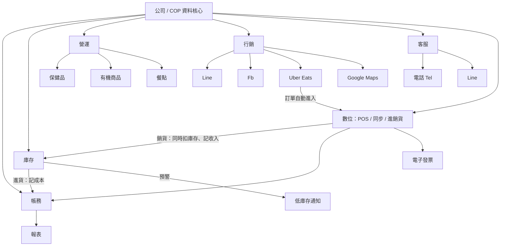

# 營運系統設計（v4，依清晰版組織圖＋已確認事項）

> v2 以第二張清晰組織圖為主架構；第一張草圖的概念（COP 核心、錢貨一起、Line 記帳、每週貼文）整合進各模組。
> **已確認**：第三框＝「營運」（含保健品、有機商品、餐點）；最右框＝「數位」（POS、內部同步、進／銷貨）；Uber 指 Uber Eats，需**自動串接**；業務**零售＋餐飲**皆有；**4 人**使用；**需要電子發票**。
> **第二輪決議**：餐點**不建立配方**（只記收入，不扣食材庫存）；保健品**要批號與效期**；POS 用**平板與手機**；店員**看不到成本與報表**；電子發票服務商與 Uber Eats 串接**先略過**。
> 第 8 節為決議摘要。

## 1. 組織圖解讀

公司下分六大模組：

| 模組 | 圖上內容 | 系統功能 |
|---|---|---|
| **帳務** | 所有成本、收入、支出、報表 | 總帳、成本／收入／支出登錄、各式報表 |
| **庫存** | POS＋進銷貨；即時存貨／預警 | 即時存貨、低庫存預警，由 POS 與進銷貨驅動 |
| **營運** | 保健品、有機商品、餐點 | 商品與餐點主檔；餐點不建配方，只記收入；保健品記批號與效期 |
| **行銷** | Line、Fb、Uber、Google Maps | 五個通路的貼文／上架／評論管理 |
| **客服** | Tel ＋ Line | 電話與 Line 客人問題紀錄、回覆、FAQ |
| **數位** | POS、內部同步、進／銷貨 | 數位化核心：POS、各系統內部同步、進銷貨單、電子發票、Uber Eats 串接 |

> 第一張圖的 COP 在這張圖對應「公司」這一層：六個模組共用同一份資料，COP = 共用的資料核心。

## 2. 整體架構



設計原則：
1. **一份資料**：商品、客戶、庫存、帳只存在 COP，各模組共用。
2. **錢貨同步**：POS 賣一筆 = 一筆收入（帳務）＋ 一筆庫存異動，同一個資料庫交易完成。進貨 = 一筆成本 ＋ 庫存增加。
3. **即時**：庫存隨交易立刻變動，達到門檻立刻預警。

## 3. 各模組設計

### 3.1 帳務
- 登錄類型：**收入、成本、支出**（對應圖上「所有成本、收入、支出」）。
- 來源：POS 自動、進貨自動、手動輸入、**Line 記帳**（傳一句話即記，機器人回覆確認；例：`支出 午餐 120`、`進貨 有機糙米 10包 2300`）。
- 報表：日／週／月損益、毛利、依商品分類（保健／有機）與通路分析、匯出 CSV 給會計。

### 3.2 庫存
- 存貨量 = 所有異動加總。異動只新增不修改：進貨、銷貨、退貨、盤點、報廢。
- **即時存貨**：每個商品、每個據點的當前數量。
- **預警**：低於安全庫存時通知（Line／畫面紅字）；可延伸「預估可售天數」。
- 進銷貨單：進貨單（供應商、成本）、銷貨由 POS 自動產生。

### 3.3 營運（商品與餐點）
- 品項三類：**保健品、有機商品**（實體商品，直接扣庫存）、**餐點**（現做，不直接有庫存）。
- 餐點**不建立配方**：賣出只記收入（可填單份成本供毛利參考），**不扣庫存**。日後要追食材成本再加配方功能。
- 保健品**必須記批號與有效期限**，銷貨依「效期最近者先出」（FEFO）扣庫存，並提示即將到期品項。
- 保健品建議加批號與有效期限（❓視需求）。
- 各通路可售狀態：品項是否在 Uber Eats、Line 上架。

### 3.4 行銷
- 通路：Line、Fb、Uber、Google Maps。
- 功能：
  - 貼文／活動排程（Fb、Line；建議每週 1–2 篇，沿用第一張草圖）。
  - **Uber Eats（自動串接）**：菜單與上架狀態同步、訂單自動進入 POS（見 3.6）。
  - Google Maps：商家資訊、評論回覆追蹤。
- 每個客人與訂單記錄來源通路，可比較各通路成效。

### 3.5 客服
- 管道：電話（Tel）＋ Line。
- 每筆客人問題記錄：客人、管道、內容、標籤、是否已回覆。
- 彙整成 FAQ，可回饋給行銷（貼文題材）與 Line 自動回覆。
- 電話只能手動登錄；Line 可由 webhook 自動進入收件匣。

### 3.6 數位（POS、同步、進銷貨、發票、串接）
- 門市 POS：選品／餐點 → 結帳 → 開立電子發票 → 完成。
- **內部同步**：結帳立刻同步庫存與帳務（圖上「POS 內…同步進／銷貨」）。
- **電子發票**：結帳時開立（可選載具、統編），作廢／折讓有對應流程。需選定發票服務商（❓）。
- **Uber Eats 串接**：接收訂單 → 自動建立 `sale`（來源=uber）→ 同樣扣庫存、記帳；同步菜單與可售狀態；平台抽成記為支出。需向 Uber 申請 API 權限，時程不由我們控制，故排在後期，之前可先手動登錄。
- 退貨／作廢：產生反向帳與反向庫存，不刪除。
- 目前以單一店面為前提，資料表保留 `store_id`，日後擴店不必改結構。

## 4. 資料模型

```
store(id, name)                                              -- 店面（目前 1 間）
customer(id, name, phone, line_id, fb_id, source_channel)
inquiry(id, customer_id, channel[tel|line], content, tag, replied, replied_at)  -- 客服 / FAQ
post(id, channel[line|fb|uber|gmaps], topic, scheduled_date, status)            -- 行銷

item(id, name, type[product|meal], category[health|organic|meal], unit, price, cost, safety_stock, batch_tracking, active)
item_listing(item_id, channel, listed)                       -- 各通路可售狀態
user(id, name, role[owner|staff])                            -- 4 位使用者與權限
stock_move(id, store_id, item_id, qty_delta, move_type[purchase|sale|return|adjust|scrap], ref_type, ref_id, batch_no, expiry, created_by, created_at)

purchase(id, supplier, total, created_at); purchase_line(...)
sale(id, store_id, customer_id, channel[pos|uber|line], total, pay_method, status[done|void], invoice_no, external_order_id, created_at); sale_line(...)
invoice(id, sale_id, number, carrier, tax_id, status[issued|void], issued_at)

ledger(id, date, kind[income|cost|expense], amount, item_id?, store_id?, ref_type, ref_id, source[pos|purchase|line|manual], note, voucher_url)
```

規則：
- `sale` / `purchase` 建立時，同一交易內寫入 `ledger` 與 `stock_move`；餐點只寫 `ledger`，不寫 `stock_move`。
- `stock_move` 只新增；更正用反向異動。
- 現有庫存 = `SUM(qty_delta)`，按 `store_id, item_id` 分組。

## 5. 主要流程

- **銷貨**：POS 結帳 → 寫 `sale` + `ledger(收入)` + `stock_move(−)`（餐點不扣庫存；保健品 FEFO）→（日後）開電子發票 → 檢查預警。
- **Uber Eats 訂單（日後）**：平台推送訂單 → 自動建立 `sale` → 同上扣庫存、記帳、開票。
- **進貨**：建立進貨單（或 Line 傳「進貨 …」）→ `ledger(成本)` + `stock_move(+)`。
- **客服循環**：客人電話／Line 詢問 → 登錄與回覆 → 標籤 → FAQ → 行銷題材。
- **月結**：帳務報表匯出給會計。

## 6. 建議技術

| 層 | 建議 |
|---|---|
| 後台 / POS 畫面 | Streamlit 多頁（與現有 repo 一致） |
| 資料庫 | SQLite 起步 → PostgreSQL |
| Line 記帳 / 客服 webhook | FastAPI 小服務（Streamlit 不適合收 webhook） |
| 資料存取 | SQLAlchemy |

注意：現有 `app.py` 內有寫死的 Pixabay API 金鑰，建議改用環境變數並更換金鑰。

## 7. 分期規劃

| 階段 | 內容 | 完成標準 |
|---|---|---|
| **P1** 開發中 | 營運主檔（保健／有機／餐點）、庫存（批號效期＋預警）、POS（平板／手機，錢貨同步）、基本帳務、4 人帳號與權限 | 一天營業的銷售、庫存、帳對得起來 |
| **P2** 已實作（待實機測試） | Line 記帳機器人（支出、進貨、庫存、報表、復原；見 `docs/line-setup.md`）。電子發票待服務商確定後加入 | 老闆用 Line 記帳與進貨 |
| **P3** | 客服收件匣＋FAQ、行銷排程（Line、Fb） | 客人問題與貼文都有紀錄 |
| **P4** | Uber Eats 自動串接、Google Maps 評論追蹤、報表強化 | Uber 訂單自動入帳扣庫存；看得到各通路毛利 |

> 電子發票排在 P2、Uber Eats 排在 P4：前者是法規需求且與 POS 緊密相關，後者依賴平台 API 核准。若 Uber 訂單量大，可把 P4 的 Uber 部分提前。

## 8. 決議摘要

| 項目 | 決議 |
|---|---|
| 電子發票服務商 | 先略過，之後處理（POS 預留發票欄位） |
| Uber Eats | 已有商家帳號；串接先略過 |
| 餐點配方 | 不建立 |
| 保健品批號／效期 | 要 |
| POS 裝置 | 平板、手機（介面需適合小螢幕） |
| 權限 | 老闆：全部；店員：POS 與庫存（不含成本、不含帳務報表） |

## 8.1 餐點點餐系統（獨立 App，手機／平板優先、觸控操作）

獨立的 App（`meal_app.py`），與營運後台（`ops_app.py`）各自啟動，共用同一個資料庫與使用者；餐點結帳的收入自動進後台帳務報表。

**設計原則：行動優先、觸控優先**
- 手機、平板為主：大按鈕（高度 ≥ 3.4rem）、加減鈕（－ 數字 ＋）取代輸入框、選項用大按鈕或標籤而非小圓點；手機上加減鈕、桌位格子、導覽列維持同一列不換行。
- 每頁最上方一排大型導覽鈕（外場／點餐／廚房／結帳／設定）。
- 操作像流程圖一步到位：在外場點桌子 → 直接帶著桌號與人數跳到點餐頁 → 送出後自動回到外場看該桌進入「待接單」。

**頁面**

| 頁面 | 使用者 | 內容 |
|---|---|---|
| **外場**（首頁） | 服務生、櫃台 | 上方「流程圖」：🟩空桌 → 🟥待接單 → 🟧製作中 → 🟦待上菜 → 🟨用餐中，顯示各階段桌數；下方 **1 樓／2 樓**分頁的桌位圖（每桌 4 人，顯示狀態、人數、可上菜道數）；點桌子出現操作面板：空桌「開桌點餐」（選人數）、有客人「上菜」「加點」「結帳」「換桌／併桌」；另有外帶單區。每 5 秒自動更新，餐點完成會提示 |
| **點餐** | 服務生 | 內用／外帶大按鈕；點桌位圖選桌（可選樓層）；用餐人數；點餐點加入；每道餐用 ＋／－ 調份數，常用需求用標籤（少辣、不要香菜…）＋自填；整單備註；送出到廚房 |
| **廚房** | 廚房平板 | 頂端「接單中／暫停接單」開關（可填暫停原因）；看板顯示待接單／已接單的單、桌號、需求（紅字）、等候分鐘；「接單・開始製作」→「完成出餐」 |
| **結帳** | 櫃台 | 大按鈕選訂單；每道餐的狀態與「已上菜」「取消」；分開結帳（按 ＋ 設份數）、全部結清、均分試算；付款方式大按鈕 |
| **設定**（老闆） | 老闆 | 桌位（1 樓、2 樓各幾桌，桌號自動編為 101…、201…，每桌座位數）；菜單（新增、改價、停售） |

**廚房是否接單**
- 廚房隨時可按「暫停接單」（客滿、食材售完…），外場與點餐頁會立刻顯示紅色提示與原因，**暫停期間不能送出新單（含加點、外帶）**；已送出的單照常處理。按「恢復接單」即可。
- 每張單也要廚房「接單」才開始製作：外場桌位圖會從 🟥待接單 變成 🟧製作中，服務生一眼就知道廚房有沒有接到。

**帳號與權限（餐點系統）**

| 角色 | 能進的頁面 | 說明 |
|---|---|---|
| 老闆 | 外場、點餐、廚房、結帳、設定 | 全部功能；取消整張訂單、改桌位與菜單 |
| 店員 | 外場、點餐、廚房、結帳 | 看不到成本與帳務報表 |
| **廚房帳號** | **只有廚房、點餐** | 鎖定在這兩頁：其他頁面不會出現在導覽列，手動輸入網址也進不去（會回到廚房首頁）；也不能登入營運後台（會被擋下） |

- 廚房帳號由老闆在營運後台「使用者」頁新增，角色選「廚房（只能用點餐、廚房頁）」。
- 帳號總數上限仍是 4 人（含廚房帳號），例如：老闆 ＋ 服務生 ＋ 廚房 ＋ 1 位機動。

**桌位**
- 分 1 樓、2 樓；**預設每樓 4 桌、每桌 4 人**，第一次使用自動建立（101～104、201～204），之後可在設定修改；桌位建立後，內用只能選已存在的桌。
- 同一桌只有一張未結帳訂單；同桌再點 = 加點（第 2、3… 輪）。併桌時人數相加。

**分開結帳、換桌／併桌、取消規則**：見前述；每次付款各自記一筆收入，餐點不扣庫存。

尚未做：列印廚房單、新單音效、混合付款（一筆帳拆多種付款方式）、Uber Eats 訂單自動進廚房、單品「售完」標記。

## 8.2 部署與登入安全（已實作，部署層未實測）

- **部署**：`docker compose up -d` 啟動五個服務——餐點系統（首頁）、營運後台（`/admin`）、webhook（`/line/webhook`、`/uber/webhook`）、每日備份、Caddy（自動 HTTPS，後台另加密碼）。步驟見 `docs/deploy.md`。
- **資料庫**：開啟 WAL 與等待逾時，多個程式同時讀寫同一個檔案不會互相卡住；每日以 SQLite 內建備份保留 30 天並檢查完整。
- **登入安全**：同姓名 10 分鐘錯 5 次、全部合計錯 30 次就鎖定 10 分鐘；對外上線 PIN 至少 6 位（`OPS_MIN_PIN_LENGTH`）；後台 Caddy 密碼＋系統登入兩層；廚房帳號不能進後台。
- **平板免輸入 PIN**：老闆替店員／廚房帳號產生「裝置登入連結」（存成書籤），只存雜湊、可撤銷、老闆帳號不可用。

## 8.3 Uber Eats 訂單自動進廚房（已實作，尚未用真實憑證驗證）

- 流程：Uber 通知 → 驗簽 → 回 200 → 取訂單 → 建單進廚房（外場外帶區顯示 🛵 Uber ＋短編號）→ 自動接受；廚房暫停接單則自動拒絕；廚房「完成出餐」通知 Uber；Uber 取消則自動取消或在整單備註顯示警告。
- 品項依「記住的對應 → 品名相同」對上菜單；對不上不會漏單（建立停售暫存品項並提醒核對）。對上的一律用店內菜單價格記帳。
- 失敗不默默吞掉：寫入 `external_event`，外場與廚房頁顯示警告。
- **API 網址與訂單欄位格式尚未驗證**，需用真實憑證與真實訂單校正。詳見 `docs/uber-setup.md`。

## 9. P1 實作說明

- P2 Line 記帳：`uvicorn line_server:app`，設定見 `docs/line-setup.md`。
- 營運後台：`streamlit run ops_app.py`（既有的 `app.py` 不變）。
- 餐點點餐系統：`streamlit run meal_app.py --server.port 8502`（與後台同時執行，共用資料庫）。
- 程式：`ops/db.py`（資料表）、`ops/services.py`（錢貨同步等商業規則）、`ops_app.py`（畫面）、`tests/test_services.py`。
- 資料庫：SQLite，預設 `ops.db`，可用環境變數 `OPS_DB` 指定路徑。第一次開啟會要求設定老闆 PIN。
- 金額與數量皆為整數（新台幣、件）。
