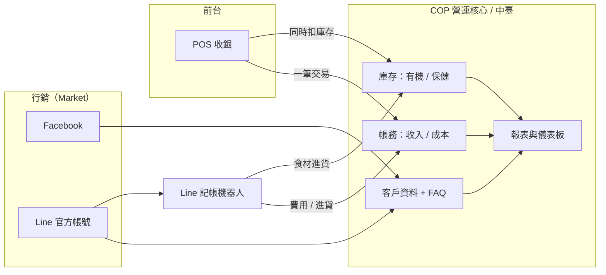

# 營運系統設計（依手繪架構圖）

> 本文件依據手繪草圖整理。草圖中有幾處字跡難辨，標記為「❓待確認」，請在「第 8 節」一併回覆，我再修正。

## 1. 草圖解讀

| 草圖元素 | 我的理解 | 系統對應 |
|---|---|---|
| Market（Fb、Line，另有一個被劃掉的通路） | 行銷／客戶通路。目前只經營 FB 與 Line，被劃掉的通路先不做 | **行銷模組** |
| 每週 1–2 篇、回覆、整理客人問題 | 貼文排程、客人留言回覆、常見問題（FAQ）彙整 | 行銷模組的三個功能 |
| Market → COP | 行銷與客戶資料匯入營運核心 | 客戶資料／來源追蹤 |
| COP（方框） | 營運核心平台（Central Operation Platform ❓） | **核心層**：主資料、權限、報表 |
| POS（COP 下方） | 銷售端，收銀 | **POS 模組** |
| Line 記帳 → 中臺 | 用 Line 傳訊息記帳，進入後台（中臺） | **Line 記帳機器人 → 帳務模組** |
| Line 記帳 → 食材 | 記帳內容會歸到「食材」進貨成本 | 記帳自動分類 |
| 存貨 →「有機」「保健」 | 商品以兩大類管理：有機、保健 | **庫存模組**（商品分類） |
| 方便即時管理、精準進出 | 庫存要即時、進出精準 | 庫存異動即時扣帳 |
| POS 一起 錢貨 | 賣出一筆，**錢（帳）和貨（庫存）同時處理** | POS 一筆交易 = 一筆帳 + 一筆庫存異動 |
| 圓圈「❓」連到 食材、服務 | 成本／營收的兩大來源：食材（實體）與服務 | 品項類型：商品／食材／服務 |
| 右下大圈（❓ 應收／憑證／重點） | 帳務重點與報表 | **帳務與報表模組** |

## 2. 整體架構



設計原則（來自草圖）：
1. **COP 是唯一資料來源**：商品、客戶、帳、庫存只在這裡存一份。
2. **錢貨同步**：任何會動到錢的事件，若涉及實體商品，必定同時產生庫存異動，在同一個資料庫交易（transaction）內完成。
3. **記帳門檻低**：老闆／店員用 Line 傳一句話就能記帳，不必開後台。

## 3. 模組設計

### 3.1 行銷模組（Market）
- **通路**：FB、Line（先只做這兩個）。
- **每週 1–2 篇貼文**：貼文排程表（主題、通路、預定日、狀態：草稿／已發／已回顧）。
- **回覆客人**：留言／訊息收件匣，標記已回覆、未回覆。
- **整理客人問題**：每則客人提問可歸類並加標籤，累積成 FAQ，之後可作為自動回覆與貼文題材。
- 與 COP 的連結：客人有「來源通路」，之後可看哪個通路帶來訂單。

### 3.2 POS 模組
- 品項選擇 → 結帳（現金／轉帳／Line Pay 等）→ 完成。
- 支援三類品項：商品（有機、保健）、食材（若現場使用）、服務。
- **一筆結帳 = 1 筆帳 + N 筆庫存異動**（服務類不扣庫存）。
- 作廢／退貨：產生反向帳與反向庫存，不直接刪除。

### 3.3 庫存模組（存貨）
- 商品分類：**有機**、**保健**（可再細分）。
- 異動類型：進貨、銷售、退貨、盤點調整、報廢。每次異動都留紀錄（誰、何時、為什麼），庫存量 = 異動加總，達到「精準進出」。
- 安全庫存與低庫存提醒（Line 推播給老闆）。
- 保健類商品加有效期限／批號（建議，視是否需追溯）。

### 3.4 Line 記帳機器人 → 中臺
- 訊息範例：
  - `午餐 120`
  - `進貨 有機糙米 10包 2300`
  - `收入 服務 1500`
- 機器人解析後，**回覆確認**（避免記錯）：「已記：進貨・有機糙米 10 包・$2300，庫存 +10」。
- 進貨類同時更新庫存；一般費用只進帳務。
- 可上傳發票／收據照片作為憑證。

### 3.5 帳務與報表
- 科目：收入（商品、服務）、成本（食材、進貨）、費用（其他）。
- 日／週／月報：營收、毛利、庫存金額、低庫存清單、熱銷品。
- 月底：匯出給會計的 CSV／Excel。

## 4. 資料模型（核心表）

```
customer(id, name, line_id, fb_id, source_channel, created_at)
inquiry(id, customer_id, channel, content, tag, replied, replied_at)      -- 客人問題 / FAQ 來源
post(id, channel, topic, scheduled_date, status)                          -- 每週貼文

item(id, name, type[product|ingredient|service], category[organic|health], unit, price, cost, safety_stock)
stock_move(id, item_id, qty_delta, move_type[purchase|sale|return|adjust|scrap], ref_type, ref_id, batch_no, expiry, created_by, created_at)

sale(id, customer_id, total, pay_method, status[done|void], created_at)
sale_line(id, sale_id, item_id, qty, unit_price)

ledger(id, date, kind[income|cost|expense], account, amount, item_id?, ref_type, ref_id, note, voucher_url, source[pos|line|manual])
```

關鍵規則：
- `sale` 建立時，在同一交易內寫入 `ledger`（收入）與 `stock_move`（銷售，負數）。
- `stock_move` 只新增、不修改；更正用反向異動。
- 現有庫存 = `SUM(qty_delta) GROUP BY item_id`。

## 5. 主要流程

**銷售（錢貨一起）**
POS 選品 → 結帳 → [交易] 寫 `sale` + `sale_line` + `ledger` + `stock_move` → 低於安全庫存則通知。

**進貨 / 食材記帳**
老闆在 Line 傳「進貨 …」→ 機器人解析 → 寫 `ledger`（成本）+ `stock_move`（進貨）→ 回覆確認。

**行銷循環**
排程貼文 → 發布 → 客人留言／提問 → 回覆 → 標記並整理成 FAQ → 下週貼文題材。

## 6. 建議技術（配合現有 repo 的 Python / Streamlit）

| 層 | 建議 | 理由 |
|---|---|---|
| 後台 / POS 畫面 | Streamlit（多頁） | 與現有專案一致，開發最快 |
| 資料庫 | SQLite（起步）→ PostgreSQL（成長後） | 免架設，結構可直接遷移 |
| Line 記帳 | Line Messaging API webhook（FastAPI） | Streamlit 不適合收 webhook，需獨立小服務 |
| 資料存取 | SQLAlchemy | 日後換資料庫不用重寫 |
| 部署 | 一台小主機或雲端容器 | 流量小，成本低 |

注意：現有 `app.py` 內有寫死的 Pixabay API 金鑰，建議之後改用環境變數／secrets，並更換該金鑰。

## 7. 分期規劃

| 階段 | 內容 | 完成標準 |
|---|---|---|
| **P1 核心** | 商品主檔、庫存異動、POS 結帳（錢貨同步）、基本日報 | 一天營業的銷售與庫存對得起來 |
| **P2 Line 記帳** | 機器人記帳＋進貨入庫＋確認回覆 | 老闆只用 Line 就能完成記帳與進貨 |
| **P3 行銷** | 貼文排程、留言收件匣、FAQ 整理 | 每週貼文與回覆有紀錄可追 |
| **P4 報表強化** | 毛利、熱銷、通路成效、月結匯出 | 月底可直接給會計 |

## 8. 需要您確認的問題

1. 草圖中 **COP** 的全名是什麼？（我暫定為營運核心平台）
2. 被劃掉的行銷通路是什麼？確定不做嗎？
3. 連到「食材」和「服務」的圓圈寫的是什麼字？右下大圈的字（應收？憑證？重點？）是什麼？
4. 您的業務型態：是零售店、餐飲，還是兩者兼有？「服務」指什麼（課程、諮詢、現場服務）？
5. 使用者有幾人？POS 用平板／電腦／手機？是否多分店？
6. 付款方式與是否需要開立電子發票？
7. 有機／保健商品是否需要批號與效期管理？
